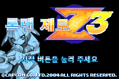

# 록맨 제로 3 · 레비아탄 한글 모드

**한국어** | [English](./README.en.md)

제로 대신 레비아탄으로 록맨 제로 3의 스테이지를 플레이하는 팬 모드다. 일본판 원본에 한글 번역·전용 타이틀·메뉴와 모드를 함께 적용한다. 창술·얼음 공격과 전용 수영을 제공하며, 추가 장비·기술·아이템은 원작 진행 중 획득한다.

## 다운로드

**[정식 v1.0.0 배포 ZIP 다운로드](https://github.com/holizero/rockman-zero3-leviathan-ko/releases/download/v1.0.0/leviathan-ko-v1.0.0.zip)** · [릴리스 안내](https://github.com/holizero/rockman-zero3-leviathan-ko/releases/tag/v1.0.0) · [ZIP 체크섬](https://github.com/holizero/rockman-zero3-leviathan-ko/releases/download/v1.0.0/leviathan-ko-v1.0.0.zip.sha256)

첨부 파일에서 **`leviathan-ko-v1.0.0.zip`** 선택. GitHub 자동 생성 `Source code (zip)`은 패치 배포 파일이 아님.

## 설치·복원

1. 배포 ZIP 전체 압축 해제
2. 브라우저에서 `레비아탄_패치도구.html` 실행
3. 일본판 원본 `.gba` 선택 → `패치 적용` → 결과를 새 파일로 저장
4. 에뮬레이터에서 새 롬 실행 → 새 게임 시작

브라우저 내부 오프라인 처리 · 별도 한글 패치·서버 불필요. 입력 원본·세이브 덮어쓰기 없음.

원본 복원: 패치 도구에서 `일본판 원본 복원` 선택 → 이 배포판의 완성 롬 입력 → `원본 복원`.

## 지원 원본

| 항목 | 기준 |
| --- | --- |
| 게임 | Rockman Zero 3 (Japan) |
| 게임 코드 | BZ3J |
| 크기 | 8,388,608바이트 |
| SHA-1 | `ff7a801776dc76e6d8c7ef73a6660ae732934a3f` |

한국어판·북미판·개발판·다른 개조판 설치 불가. 설치 전 원본·세이브 백업. 이전 버전 즉시 저장 대신 새 롬 재시작 후 게임 내 저장 사용. 세부 조작·저장 안내·검증 범위는 ZIP의 `먼저읽기.txt`·`조작표.txt`·`검증결과.json` 참조.

## 블로그 가이드

모드 소개·설치 방법·기술 GIF 페이지 공개 준비 중.

## 이용 전 확인

- 게임 원본·완성 롬·세이브·에뮬레이터 미포함
- 새 게임 추가 장비·기술·아이템 자동 지급 없음 · 원작 플레이·보상으로 획득
- 게임 내 요소 수집 시 숨겨진 기능 사용 가능
- 기존 mGBA 검증: 16개 시나리오·48,030프레임. 일부 시험용 상태 설정 포함. 전체 캠페인·실기·모든 저장 조합은 미검증
- 원작: CAPCOM / INTI CREATES. 기존 한글 번역 및 제로 1·2·3 레비아탄 자료를 바탕으로 제작한 팬 모드

## 다른 록맨 제로 3 모드

[하르퓨이아 한글 모드](https://github.com/holizero/rockman-zero3-harpuia-ko) · [오메가 제로 한글 모드](https://github.com/holizero/rockman-zero3-omega-ko). 각 모드는 일본판 원본에 개별 적용 · 중복 적용 불가.
